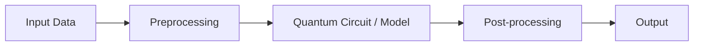

<div align="center">

# Nexora

**VTU-QFF-HC-0022** &nbsp;|&nbsp; Tier: **Both**

</div>

---

<div align="center">

| | |
| :--- | :--- |
| **Team** | Nexora |
| **Team ID** | VTU-QFF-HC-0022 |
| **Tier** | Both |
| **Repository** | [vtu-hc-nexora-0022](https://github.com/vtu-qiskit-fall-fest-2026/vtu-hc-nexora-0022.git) |
| **Organisation** | [vtu-qiskit-fall-fest-2026](https://github.com/vtu-qiskit-fall-fest-2026) |
| **Event** | VTU-QFF Hackathon — VTU-Qiskit Fall Fest 2026 |

</div>

---

## 📌 Table of Contents

- [Team Members](#-team-members-github-ids)
- [Problem Statement](#-problem-statement)
- [Proposed Solution](#-proposed-solution)
- [Approach & Architecture](#-approach--architecture)
- [Tech Stack](#-tech-stack)
- [Project Structure](#-project-structure)
- [How to Run](#-how-to-run)
- [How to Push Code](#-how-to-push-code)
- [Submission Checklist](#-submission-checklist)
- [Resources](#-resources)
- [License](#-license)

---

## 👥 Team Members (GitHub IDs)

> Members are added to this repository as **collaborators** and must accept the
> GitHub invitation before they can push. Add your GitHub username below.

| # | Name | GitHub Profile | Role |
| :-- | :--- | :--- | :--- |
| 1 | Niranjan Mathapati | [GitHub](https://github.com/NiranjanMathapati) | Team Lead |
| 2 | Iqra Sanadi | [GitHub](https://github.com/IqraSanadi22) | Developer |
| 3 | Manyata Tegnale | [GitHub](https://github.com/manyatategnale) | Developer |

<!--
Optional: add a plain list instead of the table above.
- @username1
- @username2
-->

---

## ❓ Problem Statement

<!--
State the problem you are solving. Be specific: what is broken or missing,
who experiences it, and why does it matter. Link to the official problem
statement from the brief if one applies.
-->

**Problem:** Rising temperatures and heatwaves increase cooling demand, while cooling resources may be limited. Allocating these resources across different zones with varying heat exposure and cooling needs creates an optimization challenge.

**Why it matters:** Inefficient allocation may leave high-risk zones without sufficient cooling. Exploring optimization techniques for distributing limited resources can support research into climate adaptation and heat-risk management.

**Track / Category:** Track 6 — Quantum Applications for Climate Change and Sustainability.

---

## 💡 Proposed Solution

<!--
Describe your solution. Keep it concrete: the core idea, the user flow, and
the quantum/ML technique you are applying.
-->

**Solution:** HEATSHIELD-Q is an interactive dashboard that models cooling-resource allocation across multiple zones. It compares classical optimization methods with a Qiskit-based quantum optimization approach.

**Key idea:** Formulate cooling-resource allocation as a constrained optimization problem and compare Exact Optimization, Greedy Optimization, and the Quantum Approximate Optimization Algorithm (QAOA).

**Why this works:** Comparing these approaches on the same modeled problem allows users to examine their allocation decisions and objective values. The project also explores the effect of noise on QAOA through simulation.

**Project goal:** Investigate how quantum optimization could be explored for climate-related resource allocation. The prototype does not claim that quantum optimization outperforms classical methods or has demonstrated real-world energy savings.

---
## 📊 Project Presentation

Explore our HEATSHIELD-Q presentation for an overview of the problem statement, proposed solution, QAOA-based quantum optimization approach, classical comparisons, and project results.

- 📽️ **[View HEATSHIELD-Q Presentation](VTU-QFF-NEXORA-HEATSHIELD-Q.pptx)**
- 🎬 **[Watch Project Demo](https://youtu.be/7Qv1oBpaJqU)**
- 🌐 **[Try the Live Dashboard](https://vtu-hc-nexora-0022-z6izqrs28n5usmndieb7ce.streamlit.app/)**
  
---


## 🧩 Approach & Architecture

<!--
Walk through how it works. A simple pipeline diagram in text or Mermaid is ideal.
-->



1. **Input** — Load the configured problem data, including zones, resource limits, and allocation parameters.
2. **Preprocessing** — Prepare the problem data and formulate the resource-allocation objective and constraints. Convert the allocation problem into a mathematical representation suitable for classical optimization and QAOA.
3. **Quantum core** — Use the Quantum Approximate Optimization Algorithm (QAOA) with Qiskit to construct and simulate a parameterized quantum circuit that explores possible cooling-resource allocations.
4. **Post-processing** — Measure the simulated quantum circuit, evaluate candidate allocation solutions, check their feasibility, and calculate their objective values. Compare the QAOA results with Exact Optimization and Greedy Optimization, including results from noisy simulation where applicable.
5. **Output** — Display the allocation results, objective values, comparison between optimization methods, and visualizations through the HEATSHIELD-Q interactive Streamlit dashboard

---

## 🛠️ Tech Stack

| Layer                   | Technology                                        |
| :---------------------- | :------------------------------------------------ |
| Programming Language    | Python                                            |
| Quantum SDK             | Qiskit                                            |
| Quantum Optimization    | Quantum Approximate Optimization Algorithm (QAOA) |
| Classical Baselines     | Exact Optimization and Greedy Optimization        |
| Numerical Computing     | NumPy, SciPy                                      |
| Data Handling           | Pandas                                            |
| Visualization           | Matplotlib                                        |
| Web Application         | Streamlit                                         |
| Testing                 | Pytest                                            |
| Development Environment | Python virtual environment, VS Code               |
| Version Control         | Git and GitHub                                    |


---

## 📁 Project Structure

```text
vtu-hc-nexora-0022/
├── .streamlit/
│   └── config.toml
├── docs/
│   ├── hardware_result.json
│   ├── result.json
│   ├── scaling.json
│   └── scaling.png
├── heatshield/
│   ├── __init__.py
│   ├── classical.py
│   ├── data.py
│   ├── hamiltonian.py
│   ├── problem.py
│   └── qaoa.py
├── tests/
│   └── test_model.py
├── web/
│   └── index.html
├── app.py
├── run_demo.py
├── run_hardware.py
├── run_scaling.py
├── requirements.txt
├── README.md
├── LICENSE
└── .gitignore
```


---

## 🚀 How to Run

### Prerequisites

* Python 3.11 or newer, subject to dependency compatibility.
* Git.
* A terminal or VS Code.

### 1. Clone the Repository

```bash
git clone https://github.com/vtu-qiskit-fall-fest-2026/vtu-hc-nexora-0022.git
cd vtu-hc-nexora-0022
```

### 2. Create a Virtual Environment

**Windows PowerShell:**

```powershell
python -m venv .venv
.\.venv\Scripts\Activate.ps1
```

**Linux or macOS:**

```bash
python3 -m venv .venv
source .venv/bin/activate
```

### 3. Install Dependencies

```bash
python -m pip install --upgrade pip
python -m pip install -r requirements.txt
```

### 4. Launch the Dashboard

```bash
python -m streamlit run app.py
```

Open the local address printed in the terminal.

### 5. Run the Tests

```bash
python -m pytest -q
```

### 6. Run Experiments (Optional)

```bash
python run_demo.py
python run_hardware.py
python run_scaling.py
```

Run the experiment scripts separately as needed.

**Note:** The hardware-style experiment uses a noisy simulation based on `fake_sherbrooke`. It does not imply execution on a physical quantum processor.


---

## 🔁 How to Push Code

> Full walkthrough: **[Git & Collaboration Handbook](../vtu-hc-guide-git-and-collaboration)** — collaboration
> workflow, branches, pull requests, reviews and conflict resolution.

### Configure Git (first time only)

```bash
git config --global user.name  "Your Name"
git config --global user.email "you@example.com"
```

### Everyday workflow

```bash
# 1. Get the latest changes
git checkout main
git pull origin main

# 2. Create a branch for your work
git checkout -b feature/my-task

# 3. Commit your work
git add .
git commit -m "feat: add variational circuit for the search problem"

# 4. Push the branch
git push -u origin feature/my-task

# 5. Open a Pull Request on GitHub and request a review
#    https://github.com/vtu-qiskit-fall-fest-2026/vtu-hc-nexora-0022/compare/main...feature/my-task

# 6. After approval, merge into main
git checkout main
git pull origin main
git branch -d feature/my-task
```

### Commit message convention

| Prefix | Meaning |
| :--- | :--- |
| `feat:` | New feature |
| `fix:` | Bug fix |
| `docs:` | Documentation only |
| `test:` | Adding or fixing tests |
| `refactor:` | Code restructure, no behaviour change |
| `chore:` | Build/config/dependency changes |

### Useful commands

```bash
git status              # what changed
git log --oneline -10   # recent commits
git diff                # review changes before committing
git stash               # shelve changes temporarily
git pull --rebase       # update your branch on top of main
```

### Collaborating on the same repo

- **Never push directly to `main`** — open a Pull Request.
- **Pull before you push** to avoid rejected commits.
- **Commit often** with clear messages.
- **Resolve conflicts** locally: `git pull --rebase`, fix the files, then `git add` + `git rebase --continue`.
- **Ask for a review** before merging — a second pair of eyes catches bugs fast.

---

## ✅ Submission Checklist

- [ ]README contains the project problem, solution, architecture, and setup instructions.
- [ ]Team members and GitHub profiles are listed correctly.
- [ ]Track 6 — Quantum Applications for Climate Change and Sustainability — is identified correctly.
- [ ]requirements.txt is included.
- [ ]The dashboard runs successfully.
- [ ]Tests pass.
- [ ]Required source code and project files are pushed to the assigned team repository.
- [ ]Demo video is uploaded to YouTube, as required by the event.
- [ ]Working prototype is ready for demonstration.
- [ ]Required AI assistance and external references are acknowledged.
- [ ]Final submission is completed before the official deadline.


---

## 📚 Resources

| Resource | Link |
| :--- | :--- |
| 🔁 Git & collaboration handbook | [Git & Collaboration Handbook](../vtu-hc-guide-git-and-collaboration) |
| ❓ Problem statements, solutions & terms | [Problem Statements, Solutions & Terms](../vtu-hc-guide-problem-and-solution) |
| 📄 README writing guide | [README Guide & Template](../vtu-hc-guide-readme-template) |
| ⚛️ Qiskit documentation | https://docs.quantum.ibm.com/ |
| ⚛️ Qiskit Runtime & primitives | https://quantum.cloud.ibm.com/docs/ |
| 🧪 Qiskit Aer simulator | https://docs.quantum.ibm.com/guides/simulator |
| 💻 IBM Quantum Platform | https://quantum.cloud.ibm.com/ |
| 🎓 Qiskit textbook | https://qiskit.qotlabs.org/learning/ |
| 📋 GitHub Docs | https://docs.github.com/ |

---

## 📄 License

Released under the [MIT License](LICENSE). See `LICENSE` for details.

---

<div align="center">

# Nexora

**VTU-QFF-HC-0022** | Tier: **Both**

</div>
